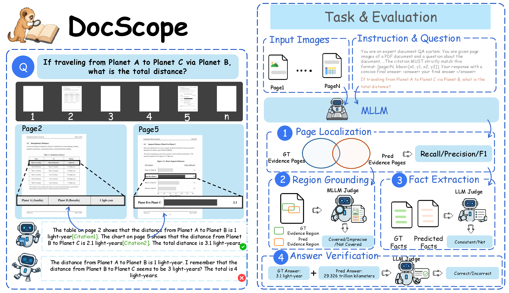

<h1 align="center">
DocScope: Benchmarking Verifiable Reasoning for<br>
Trustworthy Long-Document Understanding
</h1>

<hr>

<p align="center">
  <strong><em>Xiang Feng</em></strong><sup>1</sup>,
  <strong><em>Jiawei Zhou</em></strong><sup>1</sup>,
  <strong><em>Zhangfeng Huang</em></strong><sup>2</sup>,
  <strong><em>Kewei Wang</em></strong><sup>3</sup><br>
  <strong><em>Shanshan Ye</em></strong><sup>4</sup>,
  <strong><em>Jinxin Hu</em></strong><sup>2</sup>,
  <strong><em>Zulong Chen</em></strong><sup>2,*</sup>,
  <strong><em>Yong Luo</em></strong><sup>1,*</sup>,
  <strong><em>Jing Zhang</em></strong><sup>1,*,&dagger;</sup>
</p>

<p align="center">
  <strong><sup>1</sup> School of Computer Science, National Engineering Research Center for Multimedia Software</strong><br>
  <strong>and Hubei Key Laboratory of Multimedia and Network Communication Engineering,</strong><br>
  <strong>Wuhan University, China</strong><br>
  <strong><sup>2</sup> Alibaba Group, Hangzhou, China</strong><br>
  <strong><sup>3</sup> Independent Researcher</strong><br>
  <strong><sup>4</sup> Department of Machine Learning, Mohamed bin Zayed University of Artificial Intelligence, United Arab Emirates</strong>
</p>

<p align="center">
  <strong><sup>*</sup> Corresponding author, <sup>&dagger;</sup> Project leader</strong>
</p>

<p align="center">
  <a href="https://openreview.net/forum?id=V55GtaUSsR">NeurIPS 2026 Evaluations and Datasets Track · Poster</a>
</p>

## Overview

DocScope evaluates the verifiability of reasoning trajectories in long-document question answering. Given a complete PDF document and a question, a model produces a reasoning chain and a final answer, together with evidence pages, supporting evidence regions, and relevant factual statements. A four-stage evaluation protocol assesses page localization, region grounding, fact extraction, and answer verification, with Complete@Correct measuring evidence-chain completeness among correctly answered, answerable questions.

The benchmark contains 1,123 questions from 273 documents, with human-annotated hierarchical evidence supplemented by alternative supporting evidence. The camera-ready study evaluates 6 proprietary models, 12 open-weight models, and 5 document-understanding systems. Among the 18 general models, Complete@Correct reaches at most 38.3%, showing that correct answers can still lack complete, verifiable evidence chains.

<p align="center">
  
</p>

<p align="center">
  <strong>Figure 1.</strong> Overview of DocScope.
</p>

## Code and Data

- **Code** — the evaluation pipeline (inference backends, page / bbox / fact / answer scorers, prompt templates) lives in [`code/`](code/). See [`code/README.md`](code/README.md) for installation, the end-to-end workflow, and per-script usage.
- **Data** — annotations and PDFs are hosted at [MiliLab/DocScope](https://huggingface.co/datasets/MiliLab/DocScope). Each entry point automatically downloads and verifies its pinned version. Use `bash scripts/run_eval.sh <model_id>` for camera-ready evaluation or `bash scripts/run_eval_legacy.sh <model_id>` for the original workflow; see [setup](code/README.md).

## Citation

```bibtex
@article{feng2026docscopebenchmarkingverifiablereasoning,
  title={DocScope: Benchmarking Verifiable Reasoning for Trustworthy Long-Document Understanding},
  author={Xiang Feng and Jiawei Zhou and Zhangfeng Huang and Kewei Wang and Shanshan Ye and Jinxin Hu and Zulong Chen and Yong Luo and Jing Zhang},
  journal={arXiv preprint arXiv:2605.08888},
  year={2026},
}
```

## Camera-ready update

The [dataset](https://huggingface.co/datasets/MiliLab/DocScope) contains 1,123 questions across 273 documents, with 729 test questions and 394 development questions. The camera-ready release adds 847 alternative evidence regions and removes one counting question without localized supporting evidence. See [camera-ready metric calculation](code/eval/camera_ready/README.md) for the published metric definitions and aggregation implementation.
